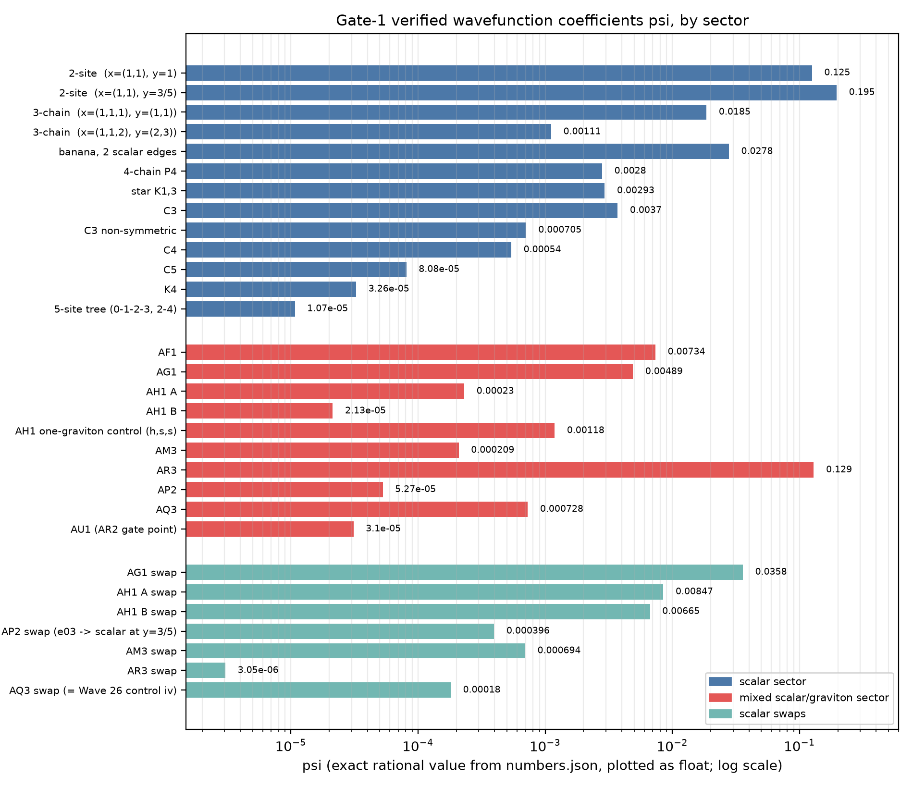
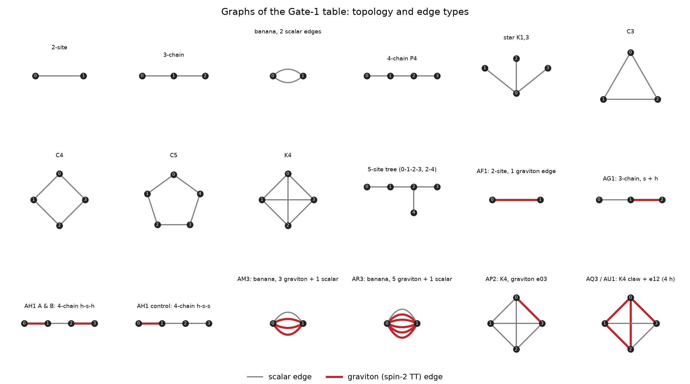

# Mixed scalar/graviton wavefunction coefficients in the cosmological-polytope sector — exact values

**Status: published in this repository on 2026-11-22, as authorised
by Rakshit. This repository is the publication of the Gate-1 bundle
(Gate-1, the campaign's publication gate, passed on 2026-11-22).**

## What this is

Exact rational values of tree-level wavefunction coefficients ψ for
graphs that mix scalar edges with spin-2 (graviton) TT edges, computed
in the flat-slicing de Sitter / cosmological-polytope framework at
M_Pl = H = 1, together with the scalar-sector values they extend.
Every value in this bundle was re-verified by an independent
implementation in exact rational arithmetic during Gate-1, and
cross-checked by independent floating-point quadrature / Monte
Carlo (the numeric reads are recorded in `numbers.md`).

Definitions. For a graph with site energies x_i and edge energies
y_e, ψ_mixed = (∏_{graviton e} C_e) · I, where

- I = ∫ ∏_i dτ_i e^{−x_i τ_i} ∏_{scalar e} G_e ∏_{graviton e} G_{h,e},
  with G_y(τ,τ′) = (1/2y)[e^{−y|τ−τ′|} − e^{−y(τ+τ′)}] and
  G_h(τ,τ′) = φ_<(τ_<)φ_>(τ_>)/y,
  φ_>(τ) = (τ+1/y)e^{−yτ},
  φ_<(τ) = (τ−1/y)e^{+yτ} + (τ+1/y)e^{−yτ};
- at each endpoint site of a graviton edge, V is the sum over
  unordered pairs of the site's scalar half-lines (external legs plus
  scalar internal half-lines) of sym2(a,b) = (a_i b_j + a_j b_i)/2;
  V^TT = PVP − (1/2)P·tr(PVP) with P = I − q̂q̂ᵀ for the edge's
  momentum q⃗; and C_e = 2·(V_A^TT : V_B^TT).

For all-scalar graphs, ψ = Ω/2^(n_e) with Ω the cosmological
polytope's canonical function and n_e the number of edges.

## Honest limits — read before citing anything

1. **The factor-2 law is not new.** ψ = Ω/2^(n_e) is a known
   normalisation convention of the published scalar formalism
   (Arkani-Hamed–Benincasa–Postnikov, arXiv:1709.02813;
   Fevola–Pimentel–Sattelberger–Westerdijk, arXiv:2410.14757 —
   "the numerator 2Y normalizes the residues of the poles of the
   integrand to be ±1"; Glew, arXiv:2503.13596). It is credited
   here as verified consistency with known conventions, **not**
   as a discovery.
2. **Sector only.** These are wavefunction coefficients of one
   positive-geometry sector. Charges provably factor out of this
   sector, so nothing here constrains hypercharge or any Standard
   Model quantum number. No unification is claimed, and this
   bundle contains no dynamics beyond the stated kernels.
3. **One borrowed lemma.** The identification of ψ with the
   polytope canonical function rests on the ABP
   facet-factorisation lemma, which is imported from the
   literature, not proved here. Any claim of an import-free
   derivation would be false.
4. **No BMV number.** No black-hole entropy (Bekenstein–Hawking /
   BMV-type) quantity is computed or claimed.
5. **Novelty status, stated exactly.** The mixed scalar/graviton
   values, the line-by-line factorisation of the contractions,
   the shared-site bookkeeping (including the common-momentum
   corollary), the completed K4 coverage, and the AT3 rational
   construction were **not found in the sources searched** by
   Gate-1's literature sweep (the closest sources are named in
   §1 and in this section; the search boundary is stated in this
   section). "Not found" is **not** proof of novelty: the
   search covered arXiv/web sources in English; it did not cover
   INSPIRE full text, non-English venues, textbooks, or paywalled
   journals beyond abstracts. Single-graviton-exchange wavefunction
   *functions* do exist in the cosmological-bootstrap literature
   in different conventions (e.g. arXiv:2212.07370,
   arXiv:2304.07206); what was not found is this tabulated,
   TT-projected, multi-line extension.
6. **Exact values, empirical error record.** The tabulated values
   are exact rational numbers (no rounding). The "error bars" are
   the deviations of independent floating-point reads recorded at
   computation time and at Gate-1; the largest is +0.555% (a
   tensor-grid read of the AU1 point), and Gate-1's own Monte
   Carlo reads agree with the exact values within their standard
   errors (z ≤ 1.21) in all cases.

## Contents

- `numbers.md` — the readable table (exact fractions; decimals).
- `numbers.json` — the same table, machine-readable, including the
  full-length fractions for the K4 points.

The table contains only Gate-1-verified values; stored values from
the campaign that the gate did not recompute are not included.

## Figures

Generated by `figures/make_figures.py` from `numbers.json` in this
repository; regenerate with `python3 figures/make_figures.py`
(requires matplotlib).

**Figure 1 — the verified values.** Every ψ stored in
`numbers.json`: 13 scalar-sector values, 10 mixed scalar/graviton
values, and 7 scalar-swap values, grouped and coloured by sector,
in stored order. The exact rational values are plotted as floats
on a log scale (labelled as such); the decimals at the bar ends
are 3-significant-figure roundings for display, and the exact
fractions in `numbers.json` / `numbers.md` remain the record.
What this shows: the magnitudes of the tabulated coefficients.
What it does **not** show: the entries are coefficients of
*different graphs at different kinematic points* — they are not
measurements of one quantity, and no trend or comparison between
graphs is claimed or should be read off the bar lengths beyond
the values themselves.

**Figure 2 — the graphs.** Node–edge diagrams of the graphs
whose coefficients are tabulated: topology and edge type (grey =
scalar edge, red = graviton TT edge), as named in `numbers.json`
/ `numbers.md`. AH1 points A and B share one diagram (they differ
in edge energies, not in topology or edge types); AQ3 and AU1
share one (they differ in kinematics). What it does **not**
show: the site and edge energies (x, y) of each point — those are
in the tables — and no meaning attaches to the drawn positions
of the sites.
